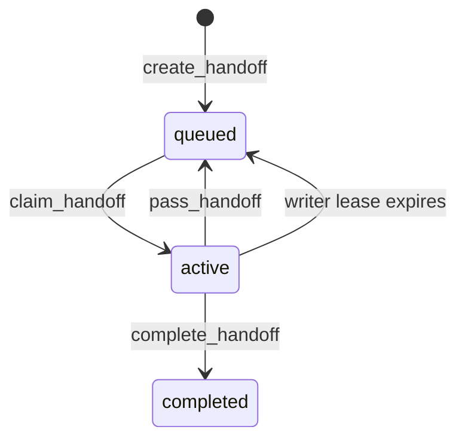

# Handoff state model

Each project has a separate SQLite ledger at `.agent-handoff/ledger.sqlite3`.

## Invariants

1. A single row in `workspace_lock` represents the project's writer lease. Every claim uses `BEGIN IMMEDIATE`, so concurrent claims serialize in SQLite.
2. A task owner must hold the current, unexpired workspace lease to pass or complete that task.
3. `pass_handoff` releases the writer lease and increments `handoff_count` in the same transaction that saves the summary, next action, changed files, and target agent.
4. A task cannot exceed its configured `max_handoffs` (default 4, allowed range 0–16).
5. An expired lease requeues its task, clears its owner, records an event, and asks the next agent to inspect the workspace before continuing.

The lease is cooperative rather than an operating-system lock. It prevents two ledger clients from claiming the writer role at once; it cannot stop tools or people that do not use the ledger.